# Classificação e Embedding — os dois fluxos do turno

> Como um turno decide **quem responde** e **o que buscar** (o fluxo de classificação, sempre por
> chat), e como ele **busca** na documentação do FRR (o fluxo do modelo de *text embedding*).
> Também mostra quando cada um roda. Reflete o tree de 2026-11-17. Os nomes de função e arquivo
> são estáveis; os números de linha mudam, por isso este documento não os usa.
>
> Documento irmão: [`RAG_RETRIEVER.md`](RAG_RETRIEVER.md), que detalha a implementação do
> retriever.

## Sumário

1. [Visão geral: dois modelos, um turno](#1-visão-geral-dois-modelos-um-turno)
2. [O fluxo de classificação](#2-o-fluxo-de-classificação)
3. [O fluxo do text embedding](#3-o-fluxo-do-text-embedding)
4. [Quando cada um é usado](#4-quando-cada-um-é-usado)
5. [Falhas e degradação](#5-falhas-e-degradação)
6. [Por que a classificação não usa embedding](#6-por-que-a-classificação-não-usa-embedding)
7. [Limitações conhecidas](#7-limitações-conhecidas)
8. [Mapa do código](#8-mapa-do-código)

---

## 1. Visão geral: dois modelos, um turno

O turno usa **dois modelos diferentes, para coisas diferentes**:

| | Modelo de **chat** | Modelo de **text embedding** |
|---|---|---|
| Qual | o da configuração do usuário (ex.: `google/gemma-4-e4b`) | `qwen3-embedding-4b` (2560 dimensões), fixo no código |
| Endpoint | `/v1/chat/completions` (classificação) e `/v1/responses` (queries e resposta) | `/v1/embeddings` |
| O que produz | texto: uma escolha numa Lista, queries, a resposta | um vetor de 2560 números por texto |
| Para que serve no turno | decidir quem responde, quais filtros usar, reescrever a busca e responder | ordenar os documentos por semelhança de sentido |
| Quando roda | todo turno | só quando o turno busca, e na ingestão (fora do turno) |

A **classificação nunca usa embedding**, e o **embedding nunca classifica**. Os dois se encontram
num ponto só: a consulta SQL da busca, em que a classificação define o `WHERE` e o embedding
define o `ORDER BY`.

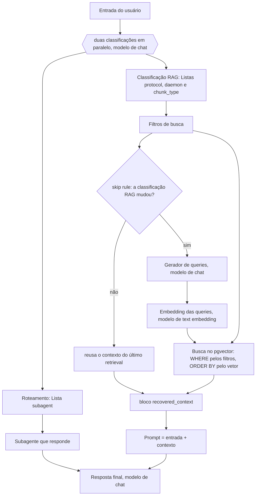

O turno inteiro mora em `turn.Run` (`internal/turn/turn.go`). O CLI (`cmd/cli`) e a UI
(`cmd/ui`) só chamam essa função e mostram o resultado.

---

## 2. O fluxo de classificação

### 2.1 O Classificador

O **Classificador** (`internal/skills/classifier`) é uma função só, usada nas duas classificações
do turno:

```go
classifier.Do(ctx, input, lists, ragMode, agent) (map[string]string, error)
```

- Recebe a entrada e uma ou mais **Listas**. Uma Lista é um conjunto fechado de valores: cada
  `Value` tem um `Name` canônico e uma `Description` opcional que ajuda o modelo a separar valores
  parecidos.
- Devolve, **para cada Lista**, exatamente um `Name` canônico ou `""`. `""` significa "nada cabe"
  e é uma resposta válida. Um valor inventado nunca sai do Classificador.
- Do `agent`, usa só `Client` e `ModelName`: nem o system prompt nem as tools dele.
- `ragMode=true` liga o **Modo RAG**, que só acrescenta um parágrafo ao prompt: "prefira o valor
  específico ao vazio".

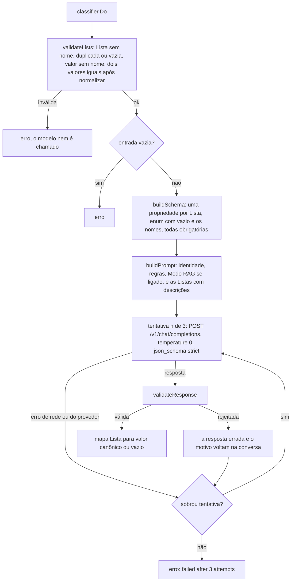

O provedor pode ignorar o schema, então a **validação no cliente é a garantia final**:

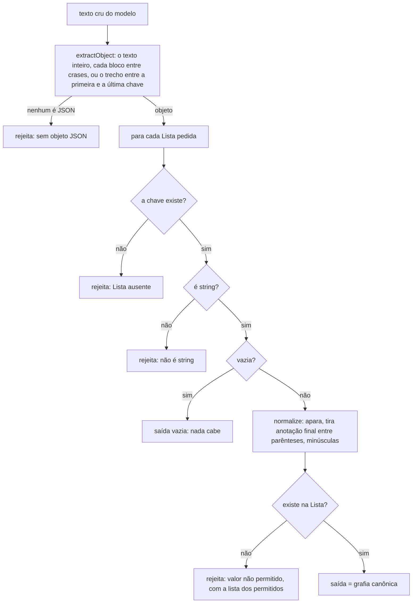

Exemplo: o modelo escreve `"OSPF (v2)"` e a saída é `ospf`. A grafia do modelo nunca passa
adiante.

### 2.2 As duas chamadas do turno

`turn.Run` faz **duas** chamadas ao Classificador, **concorrentes** (`sync.WaitGroup`), com o mesmo
agente de entrada. As perguntas são **disjuntas** de propósito:

| | Roteamento | Classificação RAG |
|---|---|---|
| Listas | `subagent` (4 valores) — `rag.SubagentList()` | `protocol`, `daemon`, `chunk_type` — `rag.FilterLists()` |
| `ragMode` | `false` | `true` |
| Pergunta | quem responde? | de que fatia da documentação é isso? |
| A saída vira | o Subagente do turno | os Filtros de busca, a chave da skip rule e uma parte do prompt do gerador de queries |
| Se falhar | o `teacher` responde, com Aviso | filtros vazios, com Aviso; o turno seguinte busca de novo |

- A Lista `subagent` fica **fora** da chamada RAG. Por isso trocar de Subagente não muda o que a
  skip rule compara e não dispara outra busca.
- As Listas de filtro ficam **fora** do roteamento. Isso deixa a pergunta do roteamento estreita,
  o que é mais rápido e não perde acerto (medido em 2026-11-17).
- A saída RAG é lida **antes**, porque o roteamento precisa dos filtros para decidir entre emitir
  Aviso e ficar em silêncio (seção 2.3).

As Listas moram numa tabela só, `rag.Lists()` em `internal/agent/rag/lists.go`. Os prompts
derivam o vocabulário dela e nunca de cópias.

| Lista | Valores |
|---|---|
| `subagent` | `builder`, `modifier`, `illustrator`, `teacher` |
| `protocol` (24) | `bgp`, `evpn`, `bmp`, `bgp-linkstate`, `ospf`, `ospf-fundamentals`, `ospf6`, `isis`, `openfabric`, `ldp`, `bfd`, `babel`, `eigrp`, `nhrp`, `basic`, `filter`, `ipv6`, `kernel`, `nexthop-groups`, `affinitymap`, `extlog`, `frr-reload`, `grpc`, `mgmt` |
| `daemon` (12) | `bgpd`, `ospfd`, `ospf6d`, `isisd`, `fabricd`, `ldpd`, `bfdd`, `babeld`, `eigrpd`, `nhrpd`, `mgmtd`, `zebra` |
| `chunk_type` | `command_reference`, `concept` |

Os valores de `protocol`, `daemon` e `chunk_type` são **exatamente** os rótulos gravados na tabela
`frr_docs`, e o teste `TestListsMatchCorpus` (`tests/internal/llm/lists_test.go`) trava isso
contra o banco. A razão: o filtro funciona por igualdade exata no `WHERE`. Um valor sem linhas
esconde o banco inteiro, e um rótulo ausente da Lista só é alcançável com o valor vazio.

### 2.3 Roteamento: de `subagent` ao Subagente

`routedName` decide o nome, e `agentForTurn` monta o Subagente a partir de
`resources/agents/<nome>/AGENT.md`. O ponto de entrada **nunca** responde: todo caminho termina
num dos quatro Subagentes ou num erro.

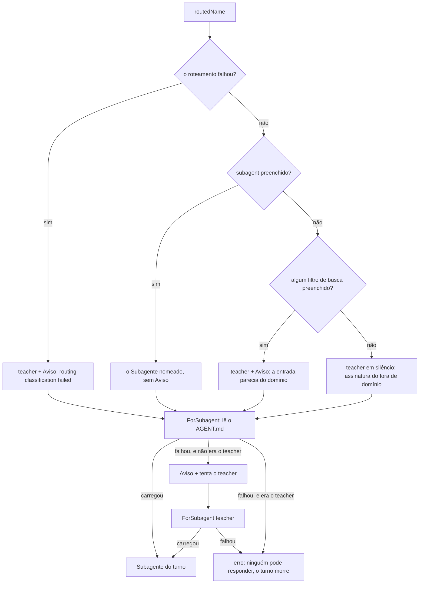

O `teacher` é o **default** (`rag.DefaultSubagent`). Para o usuário, os quatro são um agente
só, o **Newton**; os quatro nomes são papéis internos.

### 2.4 Classificação RAG: dos valores aos filtros

Exemplo real (2026-11-17, `gemma-4-e4b`). Para a entrada `Explain how a BGP session is
established.`, o modelo respondeu:

```json
{ "chunk_type": "concept", "daemon": "bgpd", "protocol": "bgp" }
```

O código transforma isso em três passos:

1. `classifier.Do` devolve `map[protocol:bgp daemon:bgpd chunk_type:concept]`.
2. `rag.FiltersFrom` converte para `rag.Filters{Protocol: "bgp", Daemon: "bgpd", ChunkType: "concept"}`.
3. `nullableStr` transforma cada `""` em `NULL`. O SQL usa `($n IS NULL OR coluna = $n)`, então
   **vazio significa "não filtra essa coluna"**, e não "não busca".

Mais dois exemplos da mesma medida:

| Entrada | Saída | Linhas que o `WHERE` deixa passar |
|---|---|---|
| "Create an frr.conf for router R1 … eBGP neighbor …" | `bgp` / `bgpd` / `command_reference` | 375 |
| "Quem é você?" | vazio / vazio / vazio | 1537, o banco inteiro |

### 2.5 A skip rule

A classificação RAG também decide **se** o turno busca. `shouldSearch` compara o mapa do turno
com o do turno anterior, valor por valor, incluindo os vazios:

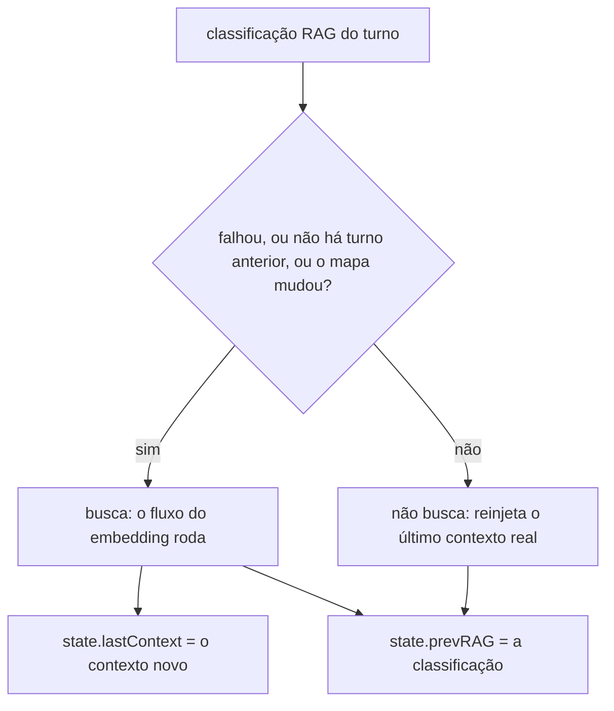

Numa conversa que continua no mesmo assunto, só o primeiro turno busca. Os seguintes reaproveitam
o contexto.

---

## 3. O fluxo do text embedding

O modelo de embedding é usado em **dois momentos**: **fora do turno**, na ingestão, que grava um
vetor por chunk no banco; e **dentro do turno**, na busca, que gera o vetor de cada query e o
compara com os do banco. A comparação só faz sentido se os dois lados usarem o **mesmo** modelo.

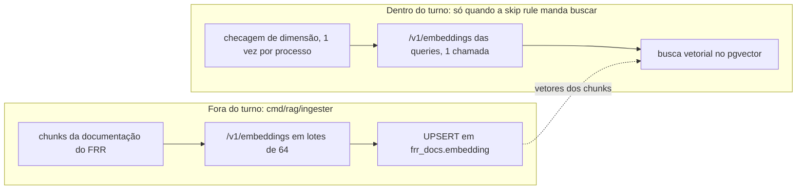

### 3.1 Ingestão (offline)

O `chucker` (`cmd/rag/chucker`) divide cada arquivo do user guide do FRR (`doc/user/*.rst`) em
chunks. `protocol` e `daemon` vêm das flags `-protocol` e `-daemon` da linha de comando, um valor
por arquivo. O `chunk_type` sai do próprio trecho: `command_reference` para a descrição de um
comando, `concept` para o resto. Cada chunk tem o seu `content` (o trecho) e o `parent_content`
(a seção inteira de onde o trecho saiu).
O `ingester` (`cmd/rag/ingester`) gera os vetores e grava:

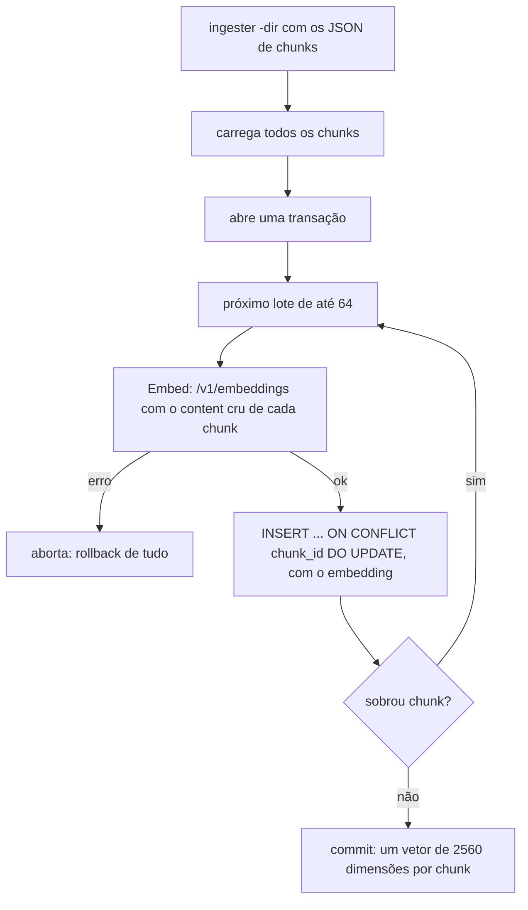

- O vetor é calculado sobre o **`content`**, o trecho. O que volta para o prompt é o
  **`parent_content`**, a seção inteira.
- O texto vai sem prefixo nem instrução, como as queries do turno.
- Hoje o banco tem **1537 chunks**.

### 3.2 A busca no turno

`turn.retrieve` monta a configuração da busca, e `ragretriever.Do` e `retriever.Retrieve`
executam:

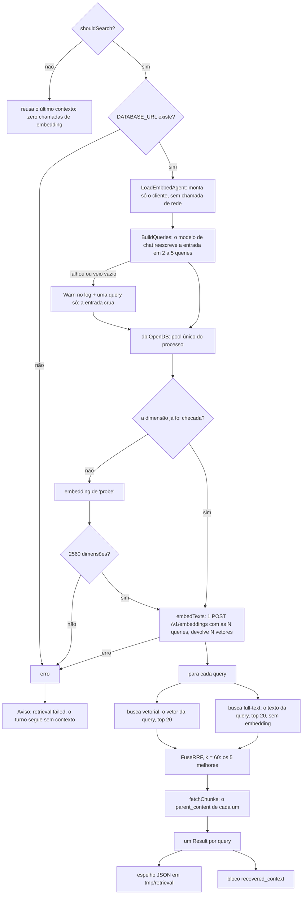

O vetor entra no SQL como parâmetro. Os filtros da classificação RAG cortam as linhas **antes**,
e o embedding só ordena o que sobrou:

```sql
SELECT chunk_id, 1 - (embedding <=> $1::vector) AS score    -- $1 = vetor da query
FROM frr_docs
WHERE ($2::text IS NULL OR daemon = $2)                     -- filtros da classificação RAG
  AND ($3::text IS NULL OR protocol = $3)
  AND ($4::text IS NULL OR chunk_type = $4)
ORDER BY embedding <=> $1::vector                           -- distância de cosseno, índice diskann
LIMIT $5;                                                   -- Limit × FetchFactor = 5 × 4 = 20
```

A busca full-text usa os mesmos filtros, mas compara **palavras**
(`content_tsv @@ plainto_tsquery('english', query)`), sem embedding. As duas listas se juntam por
Reciprocal Rank Fusion.

### 3.3 Sequência das chamadas num turno que busca

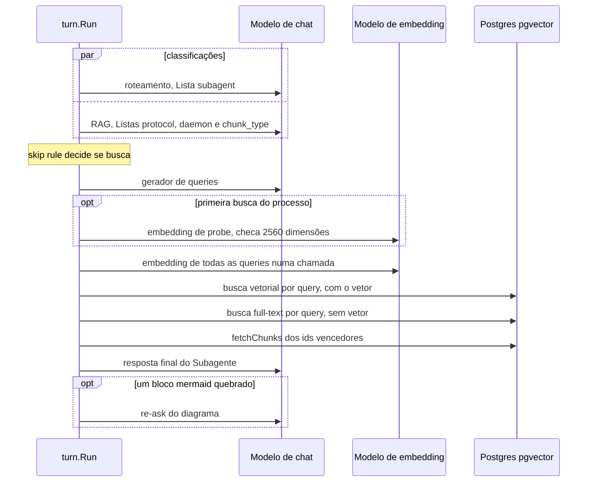

### 3.4 Qual modelo de embedding responde

| Quem pede | Nome pedido | Onde está |
|---|---|---|
| Turno | `Qwen/Qwen3-Embedding-4B-GGUF`, no LM Studio em `http://localhost:1234/v1` | `embedModel` e `localProvider` em `internal/agent/constants.go` |
| Ingester | `text-embedding-qwen3-embedding-4b` | `rag.DefaultEmbeddingModel` em `internal/agent/rag/constants.go` |

- Os dois nomes são diferentes. O LM Studio resolve ambos para a mesma instância (medido em
  2026-11-17: o `model` da resposta é igual nos dois, e o cosseno entre os vetores é 1,0).
- O provedor de embedding do turno é **fixo**: ele não segue a configuração de chat do usuário.
- A variável `EMBEDDING_MODEL` do `.env` é lida por `env.LoadEnv`, mas `turn.retrieve` descarta o
  valor.
- A checagem de dimensão só pegaria um modelo com outra dimensão. Um modelo errado de 2560
  dimensões passaria sem aviso.

---

## 4. Quando cada um é usado

Chamadas por turno, sem contar as novas tentativas do Classificador (até 3 por classificação):

| Situação | Chat | Embedding |
|---|---|---|
| Primeiro turno, ou a classificação RAG mudou | 2 classificações + 1 gerador + 1 resposta | 1 (+1 de checagem na primeira busca do processo) |
| Mesmo assunto do turno anterior (skip rule pula) | 2 classificações + 1 resposta | **0** |
| A classificação RAG falhou | 2 classificações + 1 gerador + 1 resposta | 1, com filtros vazios |
| O gerador de queries falhou ou veio vazio (comum no fora de domínio) | 2 + 1 + 1 | 1, com a entrada crua como query única |
| Um bloco Mermaid da resposta quebrou | +1 re-ask | sem mudança |
| Ingestão (`cmd/rag/ingester`), fora do turno | 0 | 1 por lote de 64 chunks |

Linha do tempo de um turno que busca, com tempos medidos em sessões do CLI (2026-11-17,
`gemma-4-e4b`). As chamadas de chat são da entrada "Explain how a BGP session is established.";
a parte do embedding, de uma busca de "Descreva-se.", já incluindo a checagem de dimensão e a
abertura do pool:

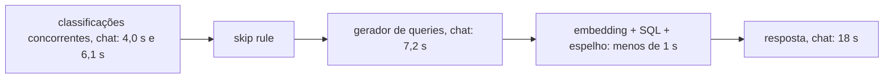

O embedding é a parte mais barata do turno. O que custa são as chamadas de chat.

---

## 5. Falhas e degradação

Nenhuma falha de classificação ou de busca derruba o turno. Cada uma vira um **Aviso** em
`Outcome.Warnings`, que o CLI imprime e a UI mostra.

| O que falhou | O que o turno faz | Aviso |
|---|---|---|
| Roteamento | responde o `teacher` | sim |
| `subagent` vazio, mas algum filtro preenchido | responde o `teacher` | sim |
| `subagent` vazio e todos os filtros vazios | responde o `teacher` | **não**: é o fora de domínio, e o roteamento funcionou |
| `AGENT.md` do Subagente nomeado | responde o `teacher` | sim |
| `AGENT.md` do `teacher` | **o turno morre**: ninguém pode responder | erro |
| Classificação RAG | filtros vazios; o turno seguinte busca de novo | sim |
| Gerador de queries | busca com a entrada crua | só no log (`Warn`) |
| `DATABASE_URL` ausente, banco, checagem de dimensão ou embedding | segue sem contexto | sim |
| Espelho JSON não gravado | segue com o contexto em memória | sim |
| Busca sem nenhuma linha | injeta o contexto com `"response": ""` | **não** (seção 7) |
| Chamada final ao modelo de chat | o turno devolve erro | erro |

---

## 6. Por que a classificação não usa embedding

O protótipo do ticket *Classificar por embedding em vez de chamada de chat*
(`.agent/generico/issues/06-classificar-por-embedding.md`, 2026-11-17) mediu a alternativa:
calcular o vetor da entrada e escolher, em cada Lista, o valor cuja descrição tem o vetor mais
próximo.

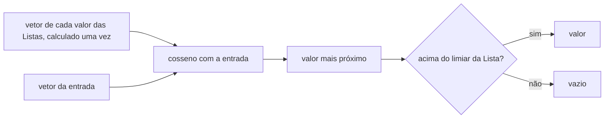

| Lista | Chat (hoje) | Embedding |
|---|---|---|
| `subagent` (domínio) | 15/15 | 7 a 10/15; o `teacher` nunca foi escolhido no 4b |
| `protocol` | 11/12 | 7/12 |
| `daemon` | 9/10 | 5/10 |
| `chunk_type` | 11/12 | 6/12, e nenhum limiar separa os dois valores |

O motivo: o embedding mede proximidade de **assunto**. O chat **lê** a instrução e as descrições.
`command_reference` e `concept` falam do mesmo assunto ("como configuro BGP" e "o que é BGP"); o
que muda entre eles é o **tipo de resposta** pedida. Além disso, o embedding sempre devolve um
valor mais próximo, então o "nada cabe" depende de um limiar ajustado à mão. Veredito do dono: a
classificação fica no chat.

Uma variante continua sem medida: mandar o vetor da entrada **direto** para a busca, sem
classificação RAG. Ela tiraria duas chamadas de chat do turno, mas perderia os filtros e a
reescrita das queries.

---

## 7. Limitações conhecidas

- **A busca sem nenhuma linha é silenciosa.** O Classificador escolhe `protocol` e `daemon` de
  forma independente, e um par incoerente (`filter` com `bgpd`) não tem linha nenhuma. O turno
  injeta `"response": ""` sem Aviso.
- **O banco não tem documentação de static, RIP, PIM nem VRRP.** Perguntas sobre esses assuntos
  buscam no banco inteiro ou em `basic` e não acham o conteúdo, porque ele não existe.
- **Uma falha de embedding fica presa até a classificação mudar.** `state.prevRAG` é gravado
  mesmo quando a busca falha, então o turno seguinte com a mesma classificação não busca de novo.
  Ele reaproveita o último contexto que deu certo (ou nenhum), e o Aviso só aparece no primeiro
  turno.
- **O turno e o ingester pedem o modelo de embedding com nomes diferentes**, e a garantia de que
  é o mesmo modelo vem do LM Studio, não da configuração (seção 3.4).
- **`embedTexts` confia na ordem de `resp.Data`** e não lê o campo `index` de cada item.
- **O LM Studio troca de modelo em silêncio.** Um `/chat/completions` que pede um modelo de
  embedding é atendido pelo modelo de chat carregado, com status 200. Um nome de modelo errado na
  configuração não gera erro.

---

## 8. Mapa do código

| Peça | Onde |
|---|---|
| Composição do turno, skip rule, roteamento, retrieval | `internal/turn/turn.go`: `Run`, `shouldSearch`, `routedName`, `agentForTurn`, `retrieve` |
| Classificador | `internal/skills/classifier`: `classifier.go` (`Do`, validação), `prompt.go` (prompt, schema, correção), `chat.go` (chamada de chat) |
| Listas e filtros | `internal/agent/rag/lists.go`: `Lists`, `FilterLists`, `SubagentList`, `FiltersFrom`, `DefaultSubagent` |
| Geração de queries | `internal/skills/rag-retriever`: `BuildQueries`, `LLMQueryGenerator`, `prompt.md` |
| Busca híbrida | `internal/agent/rag/retriever`: `Retrieve`, `FuseRRF`, `embedTexts`, `ProbeEmbeddingDim`, `queries.go`, `db.go` |
| Modelos e provedores | `internal/agent/constants.go` (`embedModel`, `localProvider`), `internal/agent/models.go` (`LoadEmbbedAgent`), `internal/agent/rag/constants.go` |
| Ingestão | `cmd/rag/chucker` (chunks), `cmd/rag/ingester` (`Embed`, `Upsert`) |
| Testes de contrato | `tests/internal/llm/lists_test.go` (`TestLists`, `TestListsMatchCorpus`), `internal/skills/classifier/classifier_test.go`, `internal/turn/turn_test.go` |
