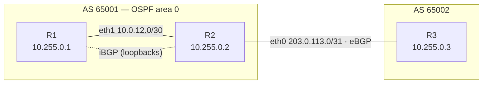
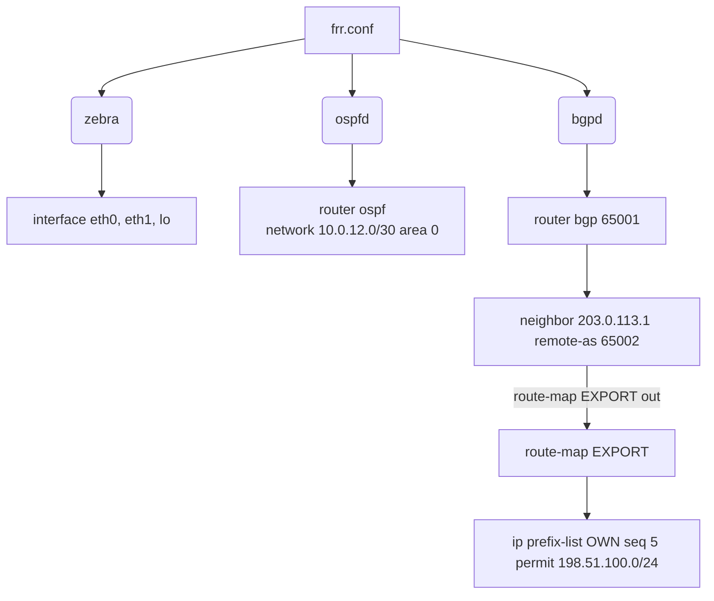

# Flowchart — topologies and configuration structure

## Header and direction

The first line is `flowchart` plus a direction (`graph` is an alias):

- `LR` left to right — topologies, chains of routers.
- `TB` (same as `TD`) top to bottom — hierarchies, configuration structure.
- `RL`, `BT` — the reverse directions.

## Nodes

An ID, optionally followed by a shape holding the label. The ID is what links refer to; the
label is what is drawn. Declare a node's label once, then use the bare ID.

| Shape | Syntax | Use it for |
|-------|--------|-----------|
| Rectangle | `R1["R1"]` | Routers, hosts, files, configuration blocks |
| Rounded | `bgpd("bgpd")` | Daemons, processes |
| Stadium | `lan(["LAN 192.168.10.0/24"])` | Networks, segments, prefixes |
| Circle | `inet(("Internet"))` | External clouds |
| Diamond | `rm10{"seq 10 match?"}` | Decisions in a policy chain |
| Hexagon | `rr{{"Route reflector"}}` | A role worth singling out |

Quote any label with spaces or punctuation: `R2["R2 (AS 65001)"]`. Inside the quotes anything
goes except a literal `"`, which is `#quot;`.

## Links

| Link | Syntax | Use it for |
|------|--------|-----------|
| Line | `R1 --- R2` | A physical link (no direction) |
| Arrow | `R1 --> R2` | A direction: advertisement, policy flow, dependency |
| Dotted | `R1 -.- R2`, `R1 -.-> R2` | A logical session (BGP over the IGP), a backup path |
| Thick | `R1 === R2`, `R1 ==> R2` | The primary or highlighted path |
| Both ways | `R1 <--> R2` | A two-way exchange |

Label a link between pipes, quoted: `R1 ---|"eth0 10.0.0.1/30"| R2`,
`R1 -->|"UPDATE 10.0.0.0/8"| R2`. Chain links on one line (`R1 --> R2 --> R3`) or fan out with
`&` (`R1 & R2 --> RR1`).

**Always put spaces around a link.** A node ID starting with `o` or `x` glued to a link turns
the link into a circle or cross edge: `zebra---ospfd` draws `zebra` linked to `spfd`. Write
`zebra --- ospfd`.

## Subgraphs

Group nodes into autonomous systems, areas, sites or daemons:

```
subgraph AS65001 ["AS 65001"]
    direction TB
    R1["R1"]
    R2["R2"]
end
```

- `subgraph ID ["Title"]` … `end`. Subgraphs nest.
- Links can point at a subgraph ID (`AS65001 --> AS65002`).
- `direction` inside a subgraph is ignored as soon as one of its nodes links to a node outside
  it — the subgraph then follows the diagram's direction.

## Example — topology



## Example — configuration structure

One router's `frr.conf`, from daemons down to the policy applied to a neighbor:



## Never write these

Styling (`classDef`, `style`, `linkStyle`, `:::`), icons, click events, Markdown strings and
the newer `@{ shape: … }` node syntax. Most of it renders — it is banned because colour
carries no meaning a label cannot, and because two of its forms are parse errors that kill the
whole diagram:

- `linkStyle 0 stroke:#FF4500;` — a hex value followed by `;`. Measured: `stroke:red;` parses
  and `stroke:#FF4500` without the `;` parses, the two together do not.
- `class R1--R2 name` — `class` takes nodes, never links.

Carry the meaning in the label and in the link styles this reference already teaches.
