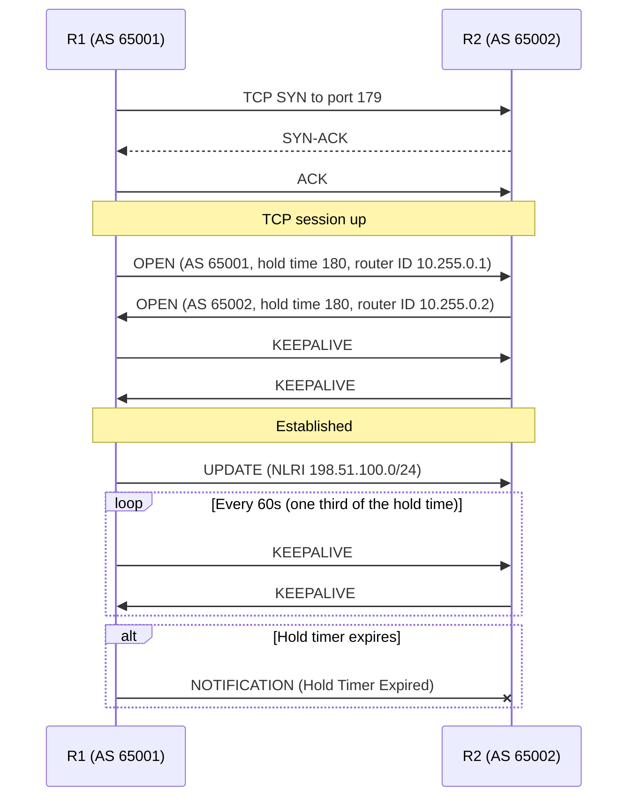

# Sequence — messages exchanged over time

## Header and participants

The first line is `sequenceDiagram`. Declare the participants first, in the order they should
appear left to right; the ID is plain, the text after `as` is what is drawn (no quotes):

```
sequenceDiagram
    participant R1 as R1 (AS 65001)
    participant R2 as R2 (AS 65002)
    actor Op as Operator
```

`actor` draws a person instead of a box. A participant used without a declaration is created
on first use, with its ID as the text.

## Messages

`Sender<arrow>Receiver: text`

| Arrow | Draws | Use it for |
|-------|-------|-----------|
| `->>` | Solid line, arrowhead | A message sent |
| `-->>` | Dotted line, arrowhead | A reply, an acknowledgement |
| `-x` | Solid line, cross | A message lost or rejected |
| `-)` | Solid line, open arrow | An asynchronous message |
| `<<->>` | Solid line, both ends | A two-way exchange |
| `->` / `-->` | Line without arrowhead | A plain line |

The text runs from `:` to the end of the line. Colons inside it are fine
(`community 65001:100`). An unescaped `;` breaks the diagram and an unescaped `#` silently cuts
the text short — write `#59;` and `#35;`. Break a line with `<br/>`.

## Notes

- `Note right of R1: text`, `Note left of R1: text`
- `Note over R1,R2: text` — spans both participants.

## Blocks

Each block closes with `end`:

| Block | Syntax |
|-------|--------|
| Repetition | `loop Every 60s` … `end` |
| Alternatives | `alt Hold timer expires` … `else KEEPALIVE received` … `end` |
| Optional step | `opt Route refresh supported` … `end` |
| In parallel | `par R1 to R2` … `and R2 to R1` … `end` |
| Must happen | `critical TCP connection` … `option Connection refused` … `end` |

`autonumber` on its own line numbers every message.

## Example — BGP session establishment



## Not covered here

Activation bars, `box` groups, `rect` highlighting, participant types (`@{ "type": … }`),
`create`/`destroy`, and links/menus on participants.
