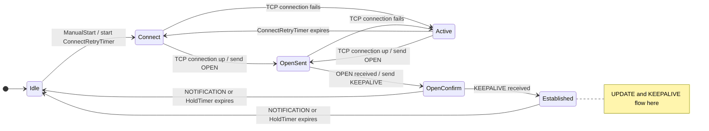
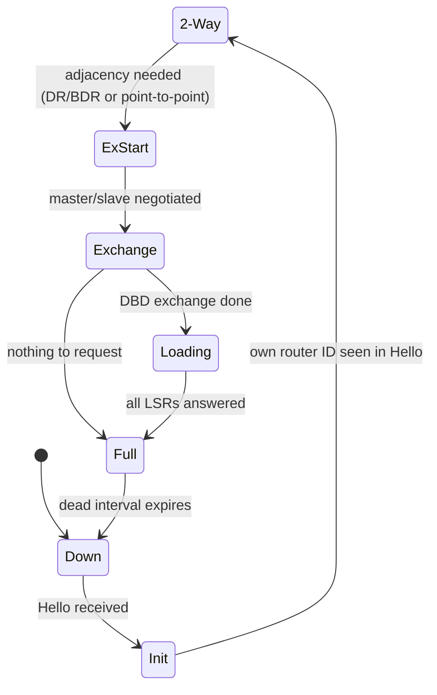

# State — protocol state machines

## Header

The first line is `stateDiagram-v2`. Add `direction LR` on the next line for a wide machine.

## States

- A state is created by its first use. Its ID is a plain word: no spaces, hyphens or colons.
- For drawn text that is not a plain word, declare the state with a description:
  `state "2-Way" as TwoWay` (or `TwoWay: 2-Way`), then use the ID.
- `[*]` is the start when it is the source of a transition, the end when it is the target.

## Transitions

`From --> To: event / action`

The label runs from `:` to the end of the line. A single colon inside it is fine
(`community 65001:100`); `::` breaks the diagram, and a raw `;` cuts the label and turns the
rest into stray states — write `#59;`.

## Composite states, choices, concurrency

- **Composite:** `state Established { … }` holds its own states, with its own `[*]`.
- **Choice:** `state check <<choice>>`, then one transition out of `check` per outcome.
- **Fork / join:** `state fork1 <<fork>>`, `state join1 <<join>>`.
- **Concurrency:** inside a composite state, `--` on its own line separates regions that run in
  parallel.

## Notes

```
note right of Idle: Waiting for a start event
note left of Established
    UPDATE and KEEPALIVE messages
    flow in this state.
end note
```

## Example — BGP finite state machine (RFC 4271, simplified)



## Example — OSPF neighbor states (states whose text is not a plain word)



## Not covered here

Styling (`classDef`, `class`, `:::`) and the older `stateDiagram` header (use `-v2`).
